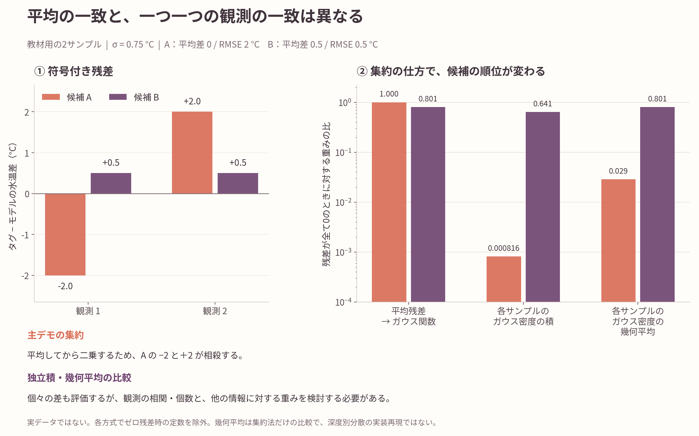

# 水温・深度履歴から位置の適合度を作る

水温による位置推定では、タグが記録した値を、候補地点の同じ深さ・対応する時刻の環境場と比べます。同じ水温になる候補は複数あり得るため、水温だけで位置が一意に定まると考えません。鉛直方向にも情報があるときは、海面水温だけに縮約せず、魚が経験した深度と併せて比較する発想が重要になります。水温・深度履歴による HMM の先行研究として Woillez ら、異なる環境尤度を組み合わせる比較対象として HMMoce を参照します。{cite:p}`Woillez2016,Braun2018`

この章では、pangeo-fish の `af4fe17`（main）の Base／Complete Notebook に共通する **主デモの温度の処理**を中心に説明します。ソースを読んで確認したもので、Notebook を実行して得た結果ではありません。論文に記載された式、主デモの式、別の研究用関数を分けます。

## 1. 主デモの計算を順にたどる

### 1.1 時間と深さを対応させる

海洋モデルの時刻ビン $t$ に入るタグのサンプルを $i=1,\ldots,n$ とし、水温を $T_i$、正を下向きとした深度を $z_i$ とします。`compute_diff` は、参照モデルの時刻境界（time bounds）から作った時間ビンにタグのサンプルを割り当て、`diff_z` に渡します。

`_diff_z` は、候補地点で水温と深度がともに有効なモデル層の中から、タグ深度に最も近い層を選びます。その操作を式で書くと、

$$
j_i=\arg\min_j\left|\max(0,z_{j,\mathrm{dynamic}})-z_i\right|,
\qquad r_i(c)=T_i-T_{\mathrm{model}}(c,j_i,t).
$$

$z_{j,\mathrm{dynamic}}$ は、瞬間的な海面からの各モデル層の深さ（`dynamic_depth`）です。海面より上にある層（負の値）は、海面の深さ0として扱います。ここで重要なのは、主デモは **最近傍のモデル層**を使うという点です。モデル水温をタグ深度へ線形補間する別関数とは、鉛直方向の比較が異なります。

### 1.2 符号付き残差を平均する

タグの深度が欠測でなく、かつ残差が計算できたサンプルについて

$$
\bar r_t(c)=\frac{1}{n_t(c)}\sum_{i\in I_t(c)}r_i(c)
$$

を計算します。$I_t(c)$ は計算に使えたサンプル集合、$n_t(c)$ はその個数を表します。本稿の記号であり、同じ名の変数が API にあることを意味しません。

この平均は符号を保持します。平均絶対誤差や二乗平均平方根誤差ではありません。主デモはこの残差場を HEALPix へ再格子化した後、ガウス関数で適合度に変えます。

### 1.3 ガウス関数で位置の重みに変える

再格子化後の残差を同じ記号で表すと、

$$
L_T(c,t)=\frac{1}{\sqrt{2\pi}s_T}
\exp\!\left[-\frac{\bar r_t(c)^2}{2s_T^2}\right].
$$

`compute_emission_pdf` に渡す `differences_std` が $s_T$ で、平均0・標準偏差 $s_T$ の正規分布の密度（`scipy.stats.norm.pdf`）に残差を入れて評価します。主デモは **0.75 °C** としています。これは関数が内部で必ず選ぶ既定値ではなく、Notebook の設定です。

`differences_std` が小さいほど、同じ残差の差を強く区別します。大きいほど、水温の違いに対して重みがなだらかになります。ただし、値を小さくすることを「位置精度を高くする」とは呼びません。誤差モデルに合わない幅を与えれば、正しい候補を強く除外し得ます。

実装へのリンク：[残差の関数](https://github.com/pangeo-fish/pangeo-fish/blob/af4fe17/pangeo_fish/diff.py)、[時刻ビンと主ヘルパー](https://github.com/pangeo-fish/pangeo-fish/blob/af4fe17/pangeo_fish/helpers.py)、[ガウス関数](https://github.com/pangeo-fish/pangeo-fish/blob/af4fe17/pangeo_fish/pdf.py)、[Complete Notebook](https://github.com/pangeo-fish/pangeo-fish/blob/af4fe17/notebooks/pangeo-fish-complete-demo.ipynb)。

## 2. 平均してから二乗することの意味

平均残差の二乗と、個々の残差の二乗の平均は異なります。

$$
\frac{1}{n}\sum_i r_i^2
=\bar r^2+\frac{1}{n}\sum_i(r_i-\bar r)^2.
$$

この恒等式から、平均残差だけでは、サンプル間の残差のばらつきを評価しないことが分かります。二つの候補セルを考えます。

| 候補セル | 2サンプルの残差 (°C) | 平均残差 (°C) | RMSE (°C) | 主デモのピーク比 $\exp[-\bar r^2/(2s_T^2)]$ |
|---|---|---:|---:|---:|
| A | −2, ＋2 | 0 | 2 | 1.000 |
| B | ＋0.5, ＋0.5 | 0.5 | 0.5 | 0.801 |

ここでは $s_T=0.75$ °C としました。A では正負が打ち消し合うので、主デモの式は A に高い重みを与えます。この例は式から計算した教材用の数値であり、実際の魚や海洋モデルのデータではありません。

一方、全サンプルに独立な同一幅のガウス誤差を仮定して積を取れば、

$$
L_{\mathrm{ind}}(c)
\propto\exp\!\left[-\frac{\sum_i r_i(c)^2}{2s^2}\right]
$$

となり、$s=0.75$ °C の場合のピーク比は A が約0.000816、B が約0.641となります。順位が逆になることから、二つの式を「どちらもガウス誤差だから同じ」と説明できません。

ただし、この比較は後者の積をそのまま採用すべきだという結論でもありません。高頻度で記録した水温には時間的依存があり得るし、同じ環境場の誤差を繰り返し観測している場合もあります。単純な積では、観測回数の増加によって重みを過度に鋭くすることがあります。平均化するなら何を情報として残したいのか、積を取るなら独立性をどこまで仮定できるかを検討します。

### 平均した値の誤差幅は自動的には決まらない

仮に、残差が独立で同じ分散 $s^2$ を持ち、系統的な偏りもなければ、平均の分散は $s^2/n$ となります。しかし、これは仮定から導かれる結果であり、現在のデモの `0.75` を自動的に $\sqrt n$ で割る根拠にはなりません。海洋モデルの系統誤差や連続サンプル間の相関があれば、同じ計算は成り立ちません。

**図：平均する順序が候補の順位を変えます。** すべて説明用の数値です。右図は残差がすべて0の場合に対する各方式の重みの比で、縦軸は対数。幾何平均は集約方法だけの比較であり、深度ごとの分散を使う関数を完全に再現したものではありません。

## 3. 論文の水温尤度と今回の式は何が違うか

Woillez et al. (2016) の方法節では、浅層・深層の温度代表値と衛星・MARS の水温を比較し、海底地形による条件を組み合わせています。主デモの「利用可能なサンプルの符号付き残差を平均してからガウス関数に入れる」式を、その論文の式そのものとして掲載しません。{cite:p}`Woillez2016`

HMMoce には海面水温、深度別温度プロファイル、海洋熱含量などの異なる尤度構成が記載されます。これも、同じ HMM の枠組みを使うことと、同一の観測モデルを使うことの違いを説明する比較材料になります。{cite:p}`Braun2018`

科学的系譜としての引用に加え、コードに基づく現在の式を併記することで、「先行研究のどの部分を受け継ぎ、どこが変わったか」を議論できます。

## 4. 分散を深度ごとに変える別実装

`diff.py` には、`interp_var_at_depth`、`likelihood_fast`、`fast_likelihood`、`likelihood_fast_gu` という別の経路があります。主デモ（Base／Complete）では呼ばれておらず、パッケージ内の他のコードからも呼ばれていません。

この経路は深度方向のモデル水温や与えられた分散を補間し、概ね

$$
S(c,t)=\exp\!\left\{
\frac{1}{n}\sum_i
\left[-\frac12\left(\log(2\pi v_i)+\frac{r_i(c)^2}{v_i}\right)\right]
\right\},
\qquad v_i=\operatorname{Var}(\Delta T\mid z_i)+0.01
$$

を計算します。温度が °C の場合、$v_i$ と加算される $0.01$ の単位は °C² です。これはガウス密度の**幾何平均**であり、独立サンプルの結合尤度として積を取った値そのものではありません。同じ $n$ なら積の単調変換だが、他の観測項と掛け合わせる際の相対的な強さは変わります。セルごとに有効サンプル数が違う場合は、比較の意味をさらに確認します。

Argo と海洋モデル（GLORYS12）の差から深度別の分散 $\mathrm{Var}(\Delta T,z)$ を推定する研究用 Notebook（リポジトリの `notebooks/new_workflow/variance_fast.ipynb`）があります。この例を利用するときは、対象海域・季節・深度の分散推定に十分な独立データがあるかを確認します。関数が存在することと、FRA の主デモで実行・評価済みであることは区別します。

## 5. 温度の不一致はセンサー誤差だけではない

研究設定を考える際には、不一致を次のように整理するとよいです。これは誤差モデルを設計するための分類であり、現行コードが各成分を独立に推定することを意味しません。

| 原因 | 確認すること |
|---|---|
| タグの測定 | 校正、温度応答時間、ドリフト、欠測、異常値 |
| 深度の対応 | 水圧から深度への変換、正負の向き、モデル層、海面からの距離と基準面 |
| 時間の対応 | UTC、観測間隔、環境モデルが瞬間値か平均値か、time bounds |
| 環境モデル | 地域・季節ごとの偏り、沿岸域、前線・成層の表現 |
| 空間の代表性 | モデルセル内での温度変動、魚の移動、HEALPix への再格子化 |

簡単な独立誤差モデルなら $s_{\mathrm{total}}^2=s_{\mathrm{tag}}^2+s_{\mathrm{model}}^2+s_{\mathrm{repr}}^2$ と足せますが、独立でない場合には共分散も必要になります。数値を入れる前に、どの誤差を含める幅なのかを定義します。

## 6. 深度・海面高度・干出に関する実装上の注意

タグの列名 `pressure` が、そのまま正を下向きとした深度として利用されます（`diff_z` は `tag["pressure"]` をタグ深度として使います）。Complete Notebook には、旧形式のタグの `Depth`／`Temp` 列を `pressure`／`temperature` に改名し、深度の符号を反転する処理があります。元データが dbar の水圧なら、列名を変えるだけでは単位の整合は取れません。研究ごとに変換と基準面を確認します。

環境モデルの鉛直座標については、海面高度 `XE` や静的水深 $H_0$ に応じた処理があります。`min_water_depth="auto"`（`compute_diff` の既定）は、モデル格子上で水柱の厚さ $H_0+XE\le0$ となる干出セル・時刻の `diff` を欠測にします。ただし、有効な `diff` を持つ湿ったセルが一つもない時刻はそのまま残されます。実際には北西ヨーロッパ陸棚（NWS）の時間値の場合だけで干出が生じるとされ、干出がなければデータは変わりません。「水深条件を満たさないセルは必ず除去される」と一文で済ませず、選んだモデル・関数の条件分岐を確認します。

さらに、**`af4fe17` では `compute_diff` の `relative_depth_threshold` は使われず、非ゼロ値を渡すと `FutureWarning` が出る**（値は属性に記録されるだけです）。Notebook の既定値は0です。このパラメータを主デモで有効な海底地形制約として説明しません。Complete の独立した bathymetry 項とは別の話です。

## 7. 図と感度分析で説明する順序

1. 一日分のタグ温度・深度と、二つの候補セルの鉛直温度分布を並べます。
2. サンプルごとの残差、平均残差、RMSE を別々に示します。
3. 再格子化の前後の残差場と、水温適合度の地図を示します。
4. `differences_std` を変えたときの適合度と推定分布を同じ色スケールで比べます。
5. 水温だけの推定と、音響・海底地形・潮汐を加えた推定を比較します。

観測を追加して分布が狭まったことは、その情報によりモデル内の候補が限定されたことを示します。位置の正確さが改善したかは、推定に使わなかった位置情報で別に評価します。検証と感度分析の設計には Gatti et al. (2021) を参照します。{cite:p}`Gatti2021`
