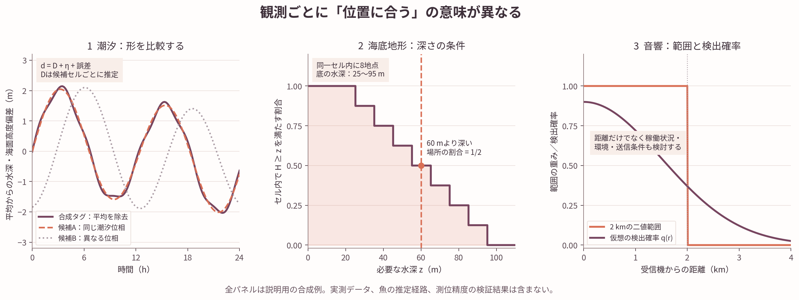
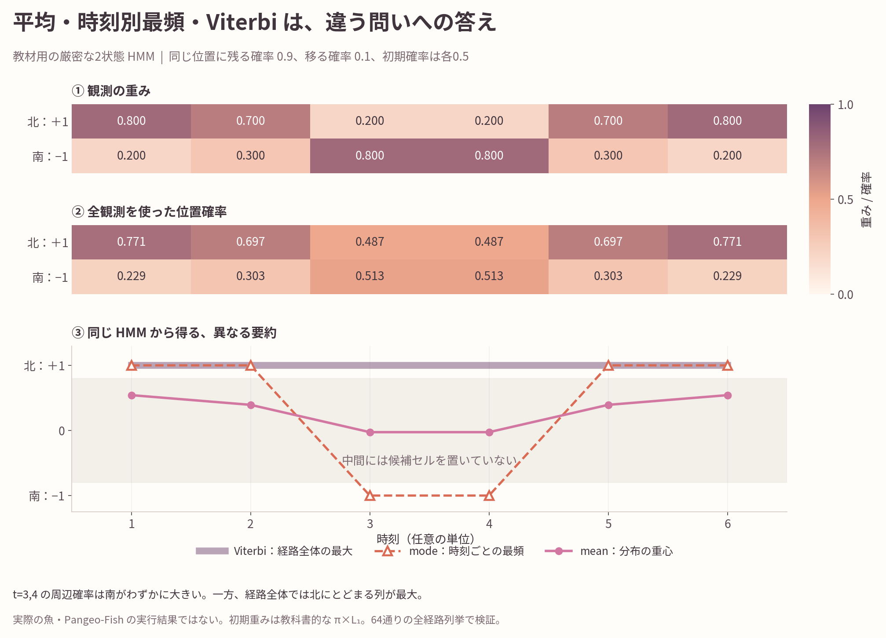

# 手法を比較し、推定結果を検証する

比較には二つの問いがあります。「この観測を加えると、どこが候補から外れるか」と「その変更によって、実際の位置をより適切に表せるか」です。前者は推定結果の変化、後者は独立な情報を使った検証として扱います。

## 1. 手法の比較表

| 情報・枠組み | 主な入力 | 制約するもの | 有効性を左右する条件 | 対象デモ |
|---|---|---|---|---|
| 水温 | タグ温度・深度、モデル水温 | 観測した水温と整合する位置 | 温度の空間勾配、モデル誤差、鉛直対応 | Base／Complete |
| 音響 | 検出記録、受信機位置・稼働期間 | 検出範囲との整合 | 検出距離と確率、稼働状況、時間ビン | Base／Complete |
| 海底地形 | 深度系列、海面高度、海底深度分布 | 観測した深さを許す場所 | 深度の基準、セル内地形、潮位補正 | Complete |
| 潮汐・`healpix` | 深度、調和定数、UTC | 潮位波形との整合（平均水深は未知として推定） | 静止区間の検出、モデル誤差、有効サンプル数 | Completeの既定経路 |
| 潮汐・`pedersen` | 深度、調和定数、UTC、セルの平均水深 | 水深＋予測潮位に対するガウス尤度（時間相関のある共分散） | 静止区間の検出、海底地形の基準面、未較正の誤差パラメータ | Completeの選択経路 |
| HMM | 観測重み、初期位置、移動カーネル | 時間的な位置のつながり | 時間間隔、σ、海域、境界、観測モデル | 全体の推定枠組み |

対象デモの欄は、`361e9b7`の二つのノートブックのどちらで使うかを示します。[Base](https://github.com/pangeo-fish/pangeo-fish/blob/361e9b7/notebooks/pangeo-fish-base-demo.ipynb)／[Complete](https://github.com/pangeo-fish/pangeo-fish/blob/361e9b7/notebooks/pangeo-fish-complete-demo.ipynb)。Completeでは、潮汐の経路を`tide_method`（既定は`"healpix"`、選択肢は`"pedersen"`）で切り替えます。

**図：観測ごとに「位置に合う」の意味が異なります。** 左は平均水深を自由に調整した後の潮汐波形の比較、中央は同一セル内の水深分布から求めた可能な深さの割合、右は2 kmの二値範囲と仮想の不完全な検出確率の比較を示します。すべて本教材で構成した合成例であり、実測データや魚の経路推定の結果ではありません。中央は生存関数の理想化で、現行実装の細部（深度に加える10、ヒストグラムの緩衝ビン、確率の下限値 $10^{-14}$）を再現したものではありません。右の滑らかな曲線は現行デモの機能や実測のレンジテスト結果を示しません。再生成用コードは `scripts/science-figures/make_observation_figure.py`。

## 2. 観測重みを掛ける意味

候補セル$c$に対し、温度・音響・海底地形・潮汐の重みをそれぞれ$L_T,L_A,L_B,L_H$とすると、Completeでは概念的に

$$
\widetilde L(c,t)=L_T(c,t)L_A(c,t)L_B(c,t)L_H(c,t),\qquad
L(c,t)=\frac{\widetilde L(c,t)}{\sum_{c'}\widetilde L(c',t)}
$$

という組み合わせを行います。実装では、`normalize_pdf`（内部で`combine_emission_pdf`）が、`initial`・`final`・`mask`を除くすべてのデータ変数を`skipna=False`で掛け合わせ、時刻ごとに空間で正規化します。回収位置が与えられている場合は、最終時刻の積に`final`分布も掛かります。これは一般に、位置と時刻を条件として各観測が独立だとする近似、または複数の整合性スコアの積と解釈できます。

**重みを増やすほど、位置が正しくなるとは限りません。** 同じ深度記録から海底地形と潮汐を作れば、情報の依存が残ります。`pedersen`方式はセルの平均水深（標準偏差10 m）も使います。自由オフセットの`healpix`方式は、Notebookの呼び出し（`water_column`を渡さない）では各窓の平均水深を推定して消すため、潮汐項から絶対深さを除きますが、共通する観測誤差や前処理まで独立になるわけではありません。

### 一様・ゼロ・欠測は違う

- 一様な正の重みは、その情報で候補セルを区別しないという意味になります。
- ゼロは、その候補を積から消します。
- 欠測は、データが不足している状態であり、実装の結合規則に応じて候補セルを消す場合があります。

重みを空間正規化しただけの地図は、移動と初期位置を反映したHMMの事後分布ではありません。図の見出しには、単独の観測重み、結合した観測重み、フィルタ分布、平滑化分布のどれかを書きます。

## 3. 平均・最頻・Viterbiを比べる

この図は一般的な離散HMMを独立に計算した合成例であり、Pangeo-Fishの再実行ではありません。上下の二つの候補に重みがあると、座標平均はその間に来ます。時刻別の最頻位置は、各時刻の周辺分布だけを見て選びます。Viterbiは、遷移の重みも含めた一連の状態列の積を最大にします。

平均が候補外・陸上に出る可能性、時刻別最頻位置が飛ぶ可能性は、一本の線だけでは見落としやすいです。実データでは背景に平滑化分布や信用集合を重ねます。

さらに、`361e9b7`のコードでは、FFTによるフィルタ・平滑化とViterbiで、実際に使う移動作用素や打ち切り幅が一致しません。Notebookの設定では、フィルタ・平滑化は`FFTConv`（`truncate=5`）、Viterbi（`viterbi_healpix`）は別に作る遷移表（打ち切りは4σ。`decode`は`truncate`を渡さないので、Notebookの`truncate`は届きません）を使います。一方、二つのσを使う場合の時刻に対するσの割り当ては、Viterbiもフィルタ・平滑化と同じ規約（遷移 $k-1\to k$ に`predictor_index[k-1]`）にそろっています。楕円体も、`decode`が予測器の楕円体（指定がなければ格子に記録された楕円体）を渡すので、WGS84の格子ならViterbiの位置もWGS84で計算されます（詳細は[HMMの章](02_hmm.md)）。線の違いをすべて「平均か最尤か」という統計的な違いだけで説明しません。[移動作用素](https://github.com/pangeo-fish/pangeo-fish/blob/361e9b7/pangeo_fish/hmm/prediction.py)／[経路の計算](https://github.com/pangeo-fish/pangeo-fish/blob/361e9b7/pangeo_fish/hmm/decode.py)

## 4. A19124で行う比較の設計

以下は**実行用の実験設計**であり、測定済みの結果ではありません。まず、期間、cell ID、楕円体、海マスク、時間ビンをそろえた共通領域を作ります。音響や潮汐の追加で利用可能日が変わった場合は、同じデータ範囲で比較できる実験と、範囲が変わる実験を区別します。

| 実験 | 使用する情報 | 主な問い |
|---|---|---|
| A | 水温 | 温度だけで識別できる海域はどこか |
| B | 水温＋音響 | 受信記録がどの時刻・海域を絞るか |
| C | 水温＋音響＋海底地形 | 深度整合が浅い候補をどう扱うか |
| D | C＋`pedersen`潮汐 | 平均水深を弱い情報として含む追加項で何が変わるか |
| E | C＋自由オフセット`healpix`潮汐 | 潮位波形の情報で何が変わるか |

実装上は`normalize_pdf`の`excluded_pdf`（または`combine_emission_pdf`の`exclude`）で、積に使う項を制御します。`361e9b7`のCompleteで各項が入るデータ変数名は、水温が`pdf`、音響が`acoustic`、海底地形が`pdf_bathy`、潮汐が`pdf_tide`です。`excluded_pdf`にこれらの名前を渡して項を外す方式が考えられますが、比較実験を組む際は、生成したDatasetの変数名を実際に確認してください。なお、潮汐の項は`merge_tide_with_total`で、他の項と共通のセルと日にそろえられます。

### σを固定した比較と、再推定した比較

まず同じ移動σで比較すると、観測を追加した直接の効果が見やすいです。次に各組み合わせでσを再推定すると、観測の変更に移動モデルがどう応答したかを見られます。両方を同じ実験として混ぜません。

各条件で、以下をそろえて出力します。

1. 単独の観測重みと、その有効セル・時刻。
2. 統合後の重みと、各時刻に正の質量があるか。
3. 平滑化分布、平均・最頻・Viterbi。
4. 推定σ、探索境界に達したか、最適化の終了状況。`parameters.json`には終了理由が保存されないため、実行時の出力（`optimize_pdf`は`fminbound`の経過を表示する）を記録しておきます。複数のσを同時に探索する場合は、Powell法の評価回数の上限（既定は20）に達していないかも確認します。
5. 信用集合の面積、独立データに対する予測性能、計算時間・最大メモリ。

同じ色の濃さが同じ量を表すよう、地図の凡例と尺度をそろえます。セルの最大値だけで自動色分けすると、鋭くなっただけの分布を改善と読み違えやすいです。

## 5. 不確実性を数値にする

平滑化確率質量$p_t(c)$を大きい順に足し、和が0.95以上となるセル集合$C_{0.95,t}$を作れば、離散的な95%信用集合を定義できます。

$$
\sum_{c\in C_{0.95,t}}p_t(c)\ge0.95.
$$

等積の全球セルであれば、セル数とセル面積から集合面積を計算できます。ただし、一部が海で一部が陸のセルをどう扱うか、海面積で報告するか、セル全面積で報告するかを明示します。確率が二つの離れた海域に分かれる場合には、二つの集合を保ちます。ひとつの円にまとめると、確率の低い間の領域を含むことがあります。

信用集合が狭いことは、モデル内部の集中度を示します。実際の位置が所定の割合で含まれるかという較正は別に検証します。正しい観測モデル・移動モデルを仮定できる程度が、事後分布の解釈を支えます。

## 6. 独立した位置情報による検証

音響記録を入力して推定したあと、同じ受信記録への近さだけを評価すると、その観測を再現できたかを調べることになります。独立な評価のためには、検出の一部を保留する、独立の測位データを使う、既知位置の固定タグを使うなど、評価のための情報を推定から分けます。

**正の検出を削除するだけでは、適切な保留にならない場合があります。** 現行ラッパーの`nondetections="mask"`では、その時刻ビンにほかの検出が残らない限り、削除した検出は未検出として扱われ、その受信機を含む稼働中の受信機の範囲が除外されます。保留対象の受信機・時間区間では、検出（受信機ごとの寄与）と未検出（時間ビンごとの除外範囲）の両方を訓練側から外し、中立な観測項として扱う必要があります。`361e9b7`のパッケージには、このように受信機と時間ビンを指定して寄与を中立にする機能はないため、自前で設計します。移動σや観測の幅をデータから選ぶときも、評価側を使わずに決めます。

受信機の検出は、魚が受信機中心にいたという点位置の観測ではありません。受信範囲や検出確率を持つ観測として、保留した検出に対する予測確率を評価します。可能なら

$$
p(y^{\rm heldout}_t\mid y^{\rm train})
=\sum_c p(y^{\rm heldout}_t\mid X_t=c)\,p(X_t=c\mid y^{\rm train})
$$

を使います。点位置が得られる場合には、距離誤差と信用集合の被覆を併記します。位置そのものが不確かな検証データなら、その誤差も説明します。観測過程の違う検証を一つの「精度」だけにまとめません。

日ごとに空間正規化した観測重みを使うスコアは、同じ観測構成の中で移動パラメータを比べる場合と、観測構成そのものを変える場合で意味が異なります。特に、入力項の違う実験の最適化スコアだけを並べて「最良の手法」と決めません。

## 7. 感度分析の順番

最初に時刻、単位、格子の対応を固定します。次に、水温誤差`differences_std`、受信範囲`receiver_buffer`と未検出の扱い（ラッパーには切替引数がない）、`healpix`潮汐の`still_tag_tide_likelihood`の`sigma`と`n_eff`（Notebookでは`sigma`と`min_samples`のみ指定。`pedersen`の誤差パラメータは未較正）、移動σの探索範囲（`maximum_speed`、`adjustment_factor`）、格子レベル`refinement_level`を一つずつ変更します。変更幅は機器精度、モデル残差、レンジテスト等から設定します。便宜的に半分・倍を試した場合は、校正された範囲ではなく探索であると書きます。

A19124の短い例で二つのσが得られたとしても、それだけでは行動別の移動特性を識別できたことになりません。期間と遷移数を増やしたデータ、複数個体、独立な行動情報による検証を研究計画に加えます。

本章の実験・評価手順は、実験の進め方の提案です。この教材では実行していません。文献上の実施例は[研究の系譜](01_scientific_lineage.md)に、実装固有の設定は[パラメータ表](11_parameters_versions.md)に分けました。

