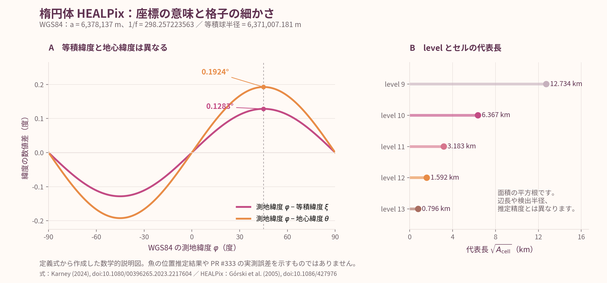

# 楕円体 HEALPix：位置・面積・解像度を区別する

## この章で理解すること

Pangeo-Fish の位置推定では、魚の候補位置を有限個のセルに分け、各時刻に各セルがどの程度もっともらしいかを計算する。HEALPix はこの候補位置を表す空間格子である。タグの水温や潮汐そのものから位置を推定する手法は観測モデルの章で扱い、ここでは「その位置をどの地球形状上の、どのセルとして表すか」を整理する。

この区別は沿岸で特に大切である。受信局、海底地形、水温場、推定経路が同じ緯度・経度を表しているつもりでも、格子の地球形状や緯度の解釈が異なれば、同じセル番号を照合しても同じ場所を指さない。

本章の幾何学的説明は、Górski et al. の HEALPix、Karney の補助緯度、GRID4EARTH の楕円体への適用に基づく。計算例と図は定義式から新たに作成した。Pangeo-Fish の具体的な実装は、`main` の `af4fe17` のソースを読んで確認した内容を、第7節に分けて記す。{cite:p}`gorski2005healpix,karney2024auxiliary,odaka2026grid4earth`

## 1. HEALPix がそろえるもの

HEALPix は Hierarchical Equal Area isoLatitude Pixelization の略である。標準的な格子は12個の基本セルから始まり、階層的に細分化できる。同じ解像度のセル面積が等しく、セル中心が一定緯度の環に並ぶことが特徴である。セルは曲線で囲まれた四辺形で、場所により形が異なる。すべての辺長や隣接中心間距離が同一という意味ではない。{cite:p}`gorski2005healpix`

格子を細かくすることと観測情報を増やすことは別である。例えば海洋モデルが十分に表現できない沿岸の水温構造は、推定格子を細分化するだけでは復元されない。より細かい格子では同じ情報を多くの候補セルに配分する場合もある。解像度は、海岸形状の表現、計算費用、結果が格子に依存する程度を一緒に見て決める。

### 確率質量と確率密度

セル $c$ の領域を $A_c$、連続空間での位置密度を $p(x)$ とすると、セルに入る確率は

$$
P_c=\int_{A_c}p(x)\,\mathrm dA.
$$

これは面積を持つ領域の**確率質量**である。小さいセル内で密度がほぼ一定なら $P_c\simeq p(x_c)|A_c|$ となる。同一レベルの等積セルでは、全セルに同じ質量を置くことが、全面積に対する一様な密度に対応する。

ただし、沿岸セルの一部だけが海である場合、「セル全体の面積」と「魚が存在できる海域の面積」は違う。海域率 $f_c$ を使って海上に一様な事前密度を表したければ、概念的には $P_c\propto f_c|A_c|$ が対応する。一方、マスク閾値でセルを採用・除外する方法は、海域率を0／1の採否に置き換える別のモデル化である。**等積格子だから海岸の扱いも自動的に適切になる、とは限らない。** この結論は上の積分式から分かる。

## 2. 三つの緯度

回転楕円体の長半径を $a$、短半径を $b$、扁平率を $f=(a-b)/a$、第一離心率の二乗を $e^2=f(2-f)$ とする。以下では楕円体表面、すなわち楕円体高 $h=0$ を考える。

| 記号 | 日本語・英語 | 幾何学的な意味 | この教材での役割 |
|---|---|---|---|
| $\varphi$ | 測地緯度・geodetic latitude | 楕円体表面の法線と赤道面の角度 | WGS84 の地理座標を受け渡す |
| $\theta$ | 地心緯度・geocentric latitude | 地球中心と地表点を結ぶ線と赤道面の角度 | 地心座標との関係を説明する |
| $\xi$ | 等積緯度・authalic latitude | 緯度帯の面積を保存して補助球へ写すための緯度 | 楕円体上の等積 HEALPix を構成する |

これらの定義と変換式は `healpix-geo` の参照系解説および Karney に詳しい。ここでは $\xi$ を等積緯度に用いる。文献で $\beta$ はしばしば更成緯度・parametric/reduced latitude を表すため、記号だけで判断しない。{cite:p}`healpixgeo_reference,karney2024auxiliary`

地心緯度には

$$
\tan\theta=(1-e^2)\tan\varphi
$$

という関係がある。しかし、この変換は面積保存の条件から導いたものではない。楕円体上の等積性が必要な場面で、等積緯度を地心緯度で置き換えることはできない。

WGS84 の $a=6\,378\,137\ \mathrm m$、$1/f=298.257223563$ を使い、本章の式から計算すると、測地緯度45度に対して次の値になる。

| 緯度の種類 | 値 |
|---|---:|
| 測地緯度 $\varphi$ | $45.00000000^\circ$ |
| 等積緯度 $\xi$ | $44.87170287^\circ$ |
| 地心緯度 $\theta$ | $44.80757678^\circ$ |



*図：左は定義式から計算した緯度の数値差、右はセル面積の平方根である。実際の魚の推定経路での誤差ではない。再現用スクリプトは `scripts/science-figures/make_healpix_figure.py`。*

## 3. なぜ等積緯度で面積がそろうのか

等積緯度の式そのものは既知であるが、ここでは面積要素からその意味を確かめる。これは図を理解するための導出であり、数値実装の推奨アルゴリズムを指定するものではない。高精度な変換方法については Karney を参照する。{cite:p}`karney2024auxiliary`

測地緯度 $\varphi$、経度 $\lambda$ の楕円体上の面積要素は

$$
\mathrm dA
=\frac{a^2(1-e^2)\cos\varphi}
       {(1-e^2\sin^2\varphi)^2}
  \,\mathrm d\varphi\,\mathrm d\lambda
$$

である。次の関数を定義する。

$$
q(\varphi)
=(1-e^2)\left[
\frac{\sin\varphi}{1-e^2\sin^2\varphi}
-\frac{1}{2e}\log\left(
\frac{1-e\sin\varphi}{1+e\sin\varphi}\right)
\right],
\qquad q_p=q(\pi/2).
$$

微分すると

$$
\frac{\mathrm dq}{\mathrm d\varphi}
=\frac{2(1-e^2)\cos\varphi}
{(1-e^2\sin^2\varphi)^2}
$$

となる。したがって、赤道から緯度 $\varphi$ までを全経度にわたって積分した帯の符号付き面積は $\pi a^2 q(\varphi)$ である。南半球では積分方向によって負になるため、通常の面積はその絶対値を取る。楕円体の全表面積は $2\pi a^2q_p$ である。

この楕円体と全表面積が等しい球の半径を $R_q$ とすると、

$$
R_q=a\sqrt{\frac{q_p}{2}},\qquad
\sin\xi=\frac{q(\varphi)}{q_p}.
$$

WGS84 では $R_q\simeq6\,371\,007.181\ \mathrm m$ になる。上の関係を使うと、球上の面積要素も

$$
R_q^2\cos\xi\,\mathrm d\xi\,\mathrm d\lambda
=\frac{a^2}{2}\,\mathrm dq\,\mathrm d\lambda
=\mathrm dA
$$

となる。この等式が面積保存の理由である。楕円体の面積を球上へ正しく運び、その球を等積セルに区切ってから逆変換すれば、楕円体上でもセル面積がそろう。経度はこの変換では変わらない。GRID4EARTH はこの考え方を HEALPix の地球観測向け実装に用いる。{cite:p}`odaka2026grid4earth`

ここで保存するのは**面積**である。すべての距離、方位、角度まで保存するという結論は上式からは出ない。面積要素が一致しても、南北方向と東西方向の長さの比が変化し得るからである。

## 4. 座標変換と位置のずれを区別する

正しく変換して $\varphi\leftrightarrow\xi$ を行き来している限り、観測点の物理的位置を動かしているわけではない。同じ位置を計算用の別の座標で表している。

問題は $\xi$ の数値を $\varphi$ として地図へ渡すなど、**数値の意味を取り違えたとき**である。上の45度の例では、その二つの数値を同じ経度の WGS84 測地緯度として読み直すと、子午線に沿った隔たりは約14.26 kmになる。この値は本章の式と子午線曲率半径の積分から計算した例である。すべての魚の経路が14 kmずれる、あるいは楕円体対応により推定誤差が14 km改善する、という結果ではない。

同様に、あるセル番号を球面の格子で緯度経度へ変換する場合と、WGS84 の格子で変換する場合では、同じ整数でも地理的な位置解釈が異なる。データの面積・位置対応と、観測誤差による魚の位置の不確実性は別の問題として評価する。

## 5. level、nside、セル数、代表長

この教材の階層レベルを $L$ とすると、

$$
N_{\mathrm{side}}=2^L,\qquad
N_{\mathrm{pix}}=12N_{\mathrm{side}}^2=12\times4^L.
$$

WGS84 の等積解釈では、セル面積と代表長は

$$
A_{\mathrm{cell}}=\frac{4\pi R_q^2}{12\times4^L},
\qquad \ell=\sqrt{A_{\mathrm{cell}}}.
$$

セル数の式は HEALPix の構成から、以下の数値は本章の WGS84 パラメータから求めた（`pangeo_fish.helpers._authalic_radius` も同じ式で $R_q$ を求めており、WGS84 では約 6371.007 km になる）。{cite:p}`gorski2005healpix`

| level $L$ | nside | 全球セル数 | セル面積（km²） | 代表長 $\sqrt{A_{\mathrm{cell}}}$（km） |
|---:|---:|---:|---:|---:|
| 9 | 512 | 3,145,728 | 162.1455 | 12.7336 |
| 10 | 1,024 | 12,582,912 | 40.5364 | 6.3668 |
| 11 | 2,048 | 50,331,648 | 10.1341 | 3.1834 |
| 12 | 4,096 | 201,326,592 | 2.5335 | 1.5917 |
| 13 | 8,192 | 805,306,368 | 0.6334 | 0.7959 |

level を1増やすと面積は4分の1、代表長は2分の1になる。半径6371 kmの球で計算しても、この表の代表長は小数第4位まで変わらない（level 10 で6.3668 km）。配布デモのコメントにある「約6.4 km」「約1.6 km」はこの値を丸めたものである。ここでいう約6.4 kmや約1.6 kmは、同じ面積を持つ正方形を仮定したときの辺長に相当する尺度である。実際の HEALPix セルの全辺長、受信半径、魚の測位誤差、海洋モデルの有効解像度を表す値ではない。

例えば level 10 で放流位置の標準偏差を約0.64 km相当に設定しても、候補位置は約6.4 kmを代表長とする離散セルである。この場合、連続空間の狭い誤差分布を格子がどのように表しているか、セル中心やセルへの割当てに結果が依存しないかを確認する必要がある。

## 6. NESTED ID はセルの識別子

HEALPix には RING と NESTED などの番号付けがある。同じ格子でも番号付けが違えば整数の意味は違う。NESTED では、level $L$ のセル番号 $p$ の4個の子は、level $L+1$ で $4p,4p+1,4p+2,4p+3$ になる。親は整数除算 $p_{\mathrm{child}}//4$ で得られる。{cite:p}`healpix_primer`

この性質は親子集約に便利である。ただし、海域だけを切り出した疎な配列では、配列の0番目が全球セル0を意味するとは限らない。さらに、「番号が近いセル」と「地図上の全隣接セル」は同じ集合ではない。セルIDを並べただけで海岸を越えない移動経路や最適なチャンクが得られるわけでもない。

データを照合するときは、少なくとも次をひと組として扱う。

- HEALPix の格子定義と向き。
- level、または nside。
- NESTED／RING などの番号付け。
- 地球形状とそのパラメータ。
- `cells` に保存された実際のセルID。

DGGS はセル識別子を用いて空間を参照する枠組みであり、特定の整数配列だけを指す名称ではない。概念モデルは OGC Topic 21、Web API は別の OGC API – DGGS 文書で扱われる。本教材で「DGGS Core」とだけ書いてこの二つを混同しない。{cite:p}`ogc2021dggs,ogc2025apidggs`

## 7. Pangeo-Fish `main`（af4fe17）は楕円体をどう扱うか

以下は、`main` の `af4fe17` のソースを読んで確認した内容である。ノートブックを実行して確かめたものではない。

### 7.1 設定と既定値

Base／Complete の配布デモの研究設定は `ellipsoid = "sphere"` で、`"WGS84"` はコメント行として選択肢に挙がっている（コメントは「必要な精度に対して地球の扁平率が無視できないときに推奨」という趣旨）。日本語のワークショップ Notebook も同じ設定で、level 10 を使う。したがって実習の既定は**球面**であり、WGS84 は利用者が選ぶ設定である。FES2022b の潮汐を使う場合だけは `ellipsoid = "WGS84"` が必須で、そうでなければ `ValueError` になる。

関数側の既定値は、`regrid_dataset_hpresample`、`compute_healpix_histogram_region_bin_size`、`viterbi_healpix` のいずれも `"sphere"` である。

### 7.2 どこで楕円体が使われているか

| 処理 | `ellipsoid` の扱い（ソースで確認） | 出典 |
|---|---|---|
| 再格子化 `regrid_dataset_hpresample` | `ellipsoid` を healpix-resample の3つのリサンプラ（陸海マスク用の双一次、Clough–Tocher、沿岸の補完用の双一次）に渡し、出力セル中心の経度・緯度を `healpix_geo.nested.healpix_to_lonlat(..., ellipsoid=...)` で計算し、`cell_ids` の属性 `ellipsoid` に保存する。リサンプラ内部の幾何は外部パッケージ側にあり、本書では確認していない | `helpers.py` 1143–1150、1181–1245、1281–1283、1319–1337 |
| 格子属性 | `grid_name`、`level`、`indexing_scheme`、`ellipsoid` を `cell_ids` の属性として書き出し、保存・再読込でも保つ | `storage.py` `_with_dggs_attrs` |
| 海底地形 | `ellipsoid` を `lonlat_to_healpix` に渡してセルIDを決める。ただし出力の `latitude`／`longitude` 座標は `healpy.pix2ang`（球面）で作られ、`cell_ids` 属性に `ellipsoid` は付かない | `bathy.py` 77、109、155–161 |
| 音響の受信域 | 格子の `ellipsoid` 属性を読み、受信域の計算に渡す。WGS84 のときは地心緯度から測地緯度へ換算する式を持つ | `helpers.py` 1746–1770、`acoustic.py` 22–49、107–179 |
| 潮汐（legacy） | `tide_to_healpix(..., ellipsoid)` が再格子化に渡す。日平均した潮汐 PDF を総合 PDF に結合するときは、`grid_name`・`level`・`indexing_scheme`・`ellipsoid` の属性が両者で食い違うと `ValueError` | `tide.py` 535–631、654–664 |
| 潮汐（HEALPix、FES2022b） | セル中心を `cell_ids` の楕円体で計算し、FES2022b は `WGS84` のセルだけを受け付ける（`WGS84` は測地緯度で、潮汐モデルの緯度に当たる） | `tide_healpix.py` 1–36、95–106、1046–1124 |
| 移動の σ の上限 | 格子の `ellipsoid` から地球半径を求める。球なら半径、楕円体なら**長半径**である（距離を長半径で割ると、その距離が楕円体上で張る最小の角度になるので、保守的な上限になる、と docstring は説明する）。属性がなければ球面とみなす | `helpers.py` 2070–2114、2164–2190 |
| 畳み込み（`conv_method`） | `HealpixAnalyseConv` と `HealpixAnalyseLargeConv` は WGS84 のみ（docstring）。`FFTConv` と `LargeHealpixConv` は `ellipsoid` を受け取る | `helpers.py` 1985–2067、2296–2300 |
| Viterbi（`viterbi_healpix`） | `ellipsoid="sphere"` なら球面の角距離を使う。それ以外では、二つのセル中心の位置ベクトル間の地心角を使い、docstring は「楕円体上の測地線距離ではない。差は小さいが高緯度で大きくなる」と注意する。ところが `decode_trajectories` → `estimator.decode` は `sigmas` だけを渡して `ellipsoid` を渡さないので、デモ経由の Viterbi の遷移は既定の `"sphere"`（打ち切り4σ）で計算される | `hmm/decode.py` 317–367、462–530、`hmm/estimator/eager.py` 316–318 |

要約すると、`main` は球面専用ではない。`ellipsoid="WGS84"` を選ぶと、セルIDとセル中心の計算、再格子化、音響の受信域、FES2022b の補間は、格子の楕円体を使って行われる。一方、次の点では球面・近似が残る。(a) 海底地形の出力座標は球面で作られる。(b) 移動の σ は長半径で距離に換算する保守的な上限を使う。(c) デモ経由の Viterbi は球面の角距離を使う。

セル属性を書き換えるだけでは観測は変換されない。`main` で WGS84 を選んだ実行では、再格子化・音響・海底地形が、それぞれ `ellipsoid` を使ってセルIDやセル中心を計算している。ただし、この確認は呼び出しの引数を追ったもので、各外部パッケージ（`healpix-geo`、`healpix-resample`）が WGS84 をどう幾何に反映するかは、本書のソースツリーには含まれないため確認していない。

`ellipsoid="WGS84"` の格子であることだけから、すべての移動計算が楕円体上の厳密な測地線距離を使うと判断できない。研究で距離誤差が重要なら、対象海域・移動尺度における近似と楕円体上の測地線を別途比較する。

## 8. 実習中に確認する最小例

`healpix-geo` の `nested.lonlat_to_healpix` は、経度と緯度（度）を受け取り、`depth` と `ellipsoid` を指定する。pangeo-fish はこの関数を `ellipsoid` を明示して呼んでいる（`bathy.py` 77、109行）。{cite:p}`healpixgeo_lonlat`

```python
import numpy as np
from healpix_geo.nested import lonlat_to_healpix

# WGS84 の測地緯度を入力する。等積緯度へ手動変換してから
# ellipsoid="WGS84" を指定すると、変換を二重に適用しかねない。
# （pangeo-fish は healpix_to_lonlat が返す緯度を、潮汐モデルの測地緯度として
#  そのまま PyFES に渡している。tide_healpix.py 1067、1122）
longitude = np.array([139.7, 142.0], dtype="float64")
latitude = np.array([35.0, 40.0], dtype="float64")

cell_ids = lonlat_to_healpix(
    longitude, latitude, depth=10, ellipsoid="WGS84"
)
```

これはAPIの入力規約を示す例であり、本書では実行していない。魚の実習 Notebook に適用するときは、使用版の regrid・音響・海底地形・経路出力まで、同じ参照系が引き継がれることを確認する。第7節の表のとおり、海底地形の出力座標や Viterbi の遷移には球面の部分が残る。

## 面談で説明できるようにしておきたい問い

1. この研究の経度・緯度は何を基準に記録されているか。
2. 球面版と WGS84 版の結果を比較するとき、同じ数値IDを同じ地理的位置だと解釈していないか。
3. 海洋モデルの元の空間情報に対して、この level を選ぶ理由は何か。
4. 狭い受信半径や放流位置の誤差を、現在のセルでどう表現しているか。
5. 出力経路の距離を測るとき、計算用の角距離と地図上の測地線距離を区別しているか。
6. 面積・座標の数値整合性と、魚の真の位置に対する精度を別々に検証しているか。

