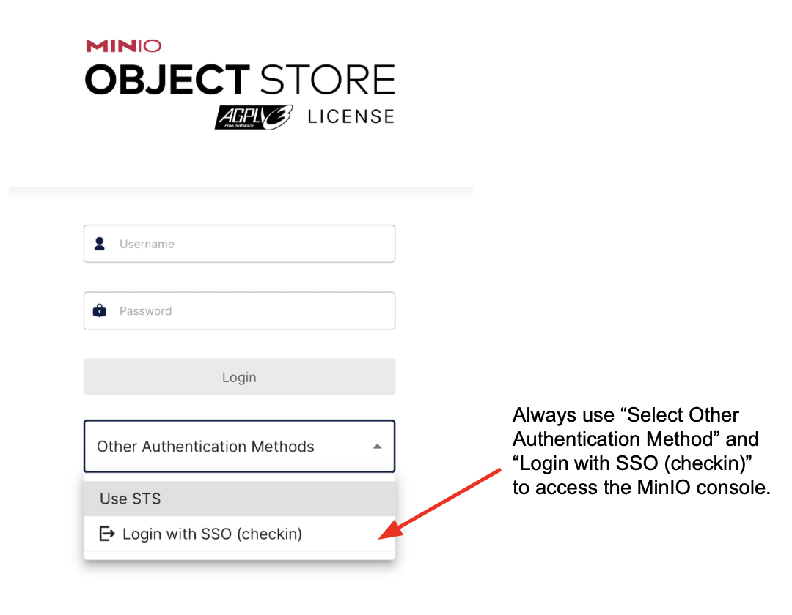
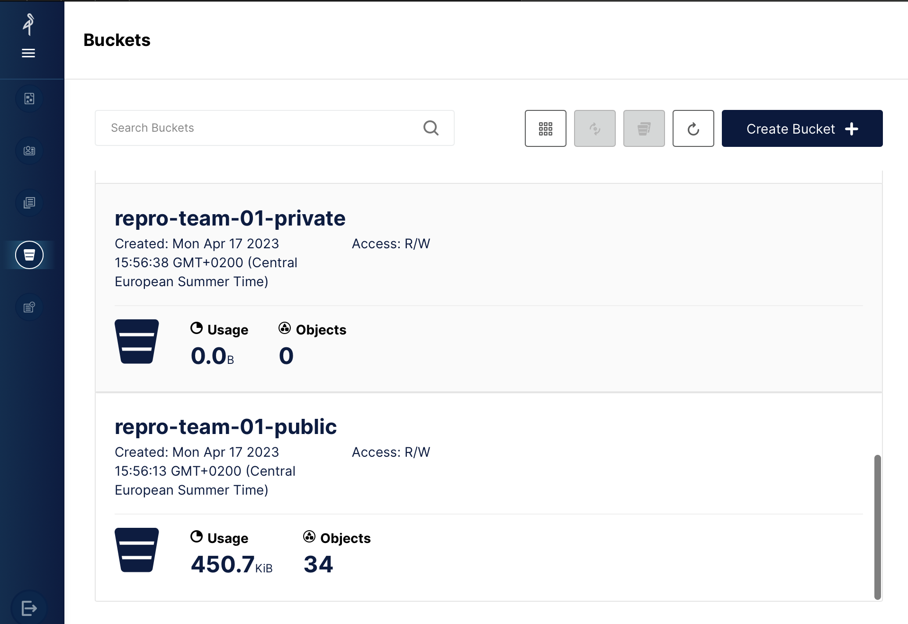

# Pangeo@EOSC への登録

前のセクションで説明したように、Pangeo@EOSC は、ヨーロッパの研究者とその共同研究者に開かれた、Pangeo エコシステムの主要な公開環境です。
この環境はヨーロッパのインフラ上で運用されており、すべてのヨーロッパの研究者が無料で使える公開の環境として維持されることを目指しています。Pangeo@Europe は、研究者向けのトレーニングに主に Pangeo@EOSC を使っています。

このセクションでは、Pangeo@EOSC のサービスに登録してアクセスする方法と、ワンクリックでワークショップの環境を起動する方法を説明します。

[EGI Check-in アカウント](https://www.egi.eu/service/check-in/)を作成し、仮想組織（Virtual Organisation、VO）`vo.pangeo.eu` に参加登録する必要があります。手順は次のとおりです。

1. [こちらの手順](https://docs.egi.eu/users/aai/check-in/signup/)に従って EGI Check-in アカウントに**サインアップ**します。**認証には [ORCID iD](https://orcid.org/) を使うことをおすすめします。**
2. 前の手順で作成した EGI Check-in アカウントで[参加登録用の URL](https://aai.egi.eu/auth/realms/id/account/#/enroll?groupPath=/vo.pangeo.eu) をクリックし、仮想組織（VO）`vo.pangeo.eu` に**参加登録**します。**"reason to join"**（参加理由）の欄には、次の文をそのまま入力してください。

   ```text
   Attend the pangeo-fish workshop at FRA in Yokohama, November 2026
   ```

   この文をそのまま使っていただくと、ワークショップの参加者であることが分かり、できるだけ早く承認できます。内容を確認して `Submit` をクリックします。

:::{warning}
VO への参加登録の承認は**手作業**で行います。**ワークショップより十分前に**（できれば数日前までに）登録してください。間に合わないと、当日ログインできないことがあります。
:::

:::{note}
**FRA 横浜ワークショップ**の終了後も、引き続きこの環境を使うことができます。
ぜひご感想をお寄せください。プラットフォームの今後の情報もお知らせします。連絡には [GitHub Discussions](https://github.com/pangeo-data/pangeo-eosc/discussions) をお使いください。

オンラインのミートアップ「Pangeo show and tell」で発表していただくこともできます。
:::

## ワークショップの環境を起動する（ワンクリック）

参加登録が承認されたら、まず [Pangeo@EOSC にログイン](https://pangeo-eosc.vm.fedcloud.eu/hub/login)します。**Sign in with EGI Check-in** をクリックし、登録に使ったのと同じ ORCID iD / EGI アカウントでログインしてください。ログインしたらこのページに戻り、下の起動リンクを使います。ログインしていない状態では、起動リンクが正しく動かないことがあります。

起動リンクは次のことを行います。

1. **pangeo-fish の Docker イメージ**（`ghcr.io/tinaok/pangeo-fish-notebook:2026.06.04-10751a5`）で JupyterLab サーバーを起動します。
2. **このリポジトリ**（`pangeo-fish-fra2026`）をホームディレクトリに**クローン**し（すでにある場合は更新し）、pangeo-fish のノートブックを開きます。

👉 **<a href="https://pangeo-eosc.vm.fedcloud.eu/hub/spawn?profile=only-choice&amp;profile-option-only-choice--image--unlisted-choice=ghcr.io%2Ftinaok%2Fpangeo-fish-notebook%3A2026.06.04-10751a5&amp;next=%2Fhub%2Fuser-redirect%2Fgit-pull%3Frepo%3Dhttps%253A%252F%252Fgithub.com%252Fpangeo-fish%252Fpangeo-fish-fra2026%26urlpath%3Dlab%252Ftree%252Fpangeo-fish-fra2026%252Fdocs%252Fpangeo-fish.ipynb%26branch%3Dmain">FRA 2026 pangeo-fish ワークショップの環境を起動する</a>** 👈

または、ログインしたあとで、次の URL をブラウザのアドレスバーにコピー＆ペーストしてください。

```
https://pangeo-eosc.vm.fedcloud.eu/hub/spawn?profile=only-choice&profile-option-only-choice--image--unlisted-choice=ghcr.io%2Ftinaok%2Fpangeo-fish-notebook%3A2026.06.04-10751a5&next=%2Fhub%2Fuser-redirect%2Fgit-pull%3Frepo%3Dhttps%253A%252F%252Fgithub.com%252Fpangeo-fish%252Fpangeo-fish-fra2026%26urlpath%3Dlab%252Ftree%252Fpangeo-fish-fra2026%252Fdocs%252Fpangeo-fish.ipynb%26branch%3Dmain
```

:::{note}
JupyterLab サーバーが**すでに動いている**場合（たとえば別のイメージで起動している場合）、上のリンクは pangeo-fish のイメージで新しいサーバーを起動せず、動いているサーバーを開きます。その場合は、先にサーバーを停止してください。JupyterLab で `File > Hub Control Panel` を開き、`Stop My Server` をクリックしてから、もう一度リンクをクリックします。
:::

このブックの各ノートブックのページ上部にある 🚀（ロケット）ボタンの `JupyterHub` からも同じこと（リポジトリのクローン・更新と、そのノートブックを開くこと）ができます。ただし、Docker イメージは自動では選ばれ**ません**。

## Pangeo@EOSC に手動でアクセスする

[https://pangeo-eosc.vm.fedcloud.eu/](https://pangeo-eosc.vm.fedcloud.eu/) から Pangeo@EOSC にアクセスすることもできます。`Sign in with EGI Check-in` をクリックし、ORCID iD でログインしてください。

サーバーのオプションの **Image** で **"Specify an existing docker image"**（カスタムイメージ）を選び、次を入力します。

```
ghcr.io/tinaok/pangeo-fish-notebook:2026.06.04-10751a5
```

固定タグ `2026.06.04-10751a5` には、このワークショップ用に準備した Pangeo-Fish のバージョンが入っています。全員が同じ環境で作業できるよう、この固定タグを使ってください。イメージは [tinaok/pangeo-fish-docker](https://github.com/tinaok/pangeo-fish-docker) でビルド・テストされています。

JupyterLab が起動したら、ターミナルを開いてこのリポジトリをクローンします。

```
git clone https://github.com/pangeo-fish/pangeo-fish-fra2026.git
```

または、前のセクションのワンクリック起動リンクを使ってください。

## どのカーネルを使うか

Docker イメージには 2 つの Python カーネルがあります。**このワークショップのノートブックでは、すべて「Python (pangeo-fish)」を使ってください**（このリポジトリからノートブックを開くと自動で選ばれます）。もう一方の「Python 3 (ipykernel)」は、pangeo-fish を含まない標準の Pangeo ノートブック環境です。

ターミナルでは、`conda activate pangeo-fish` で pangeo-fish の環境を有効にできます。

JupyterLab の実用的なヒント（すべてのセルの実行、カーネルの終了、サーバーの停止、フォルダの削除など）は {doc}`jupyterlab-basics` にまとめています。

## Copernicus Marine の認証情報

どちらのノートブックも、[Copernicus Marine Service](https://data.marine.copernicus.eu/) から海洋モデルのデータ（GLORYS、全球海洋物理再解析）をダウンロードします。そのため、Copernicus Marine の（無料の）アカウントが必要です。

1. [https://data.marine.copernicus.eu/register](https://data.marine.copernicus.eu/register) でアカウントを作成します（メールアドレスがあれば作れます。届いたメールのリンクをクリックして確認してください）。
2. **ユーザー名**（多くの場合メールアドレス）と**パスワード**を控えておきます。
3. 最初のノートブックで一度だけ入力を求められます（`copernicusmarine.login()`）。入力した情報は Pangeo@EOSC のホームディレクトリの `~/.copernicusmarine/.copernicusmarine-credentials` に保存されます。ホームディレクトリは永続的なので、再び入力を求められることはありません。

確認メールが届くまで数分かかることがあるので、アカウントは**ワークショップの前に**作成しておいてください。

## 計算資源

現在（2023 年 9 月時点）、Pangeo@EOSC は、Jupyter（8 CPU、32 GB RAM）と Dask クラスター（最大 4 ワーカー、各ワーカー 8 CPU・32 GB RAM）を 20 人が同時に使える構成になっています。この構成は、利用状況や CESNET の資源の空き状況によって変わることがあります。

計算をスケールさせるために [Dask Gateway](https://gateway.dask.org/) が使えます。この環境の詳細は [Daskhub の Helm チャート](https://github.com/dask/helm-chart/tree/main/daskhub)を参照してください。

## MinIO へのアクセス

DaskHub は大きなデータを保存するためのものではないので、各ユーザーのローカルストレージはごくわずかです。その代わりに、専用の [MinIO オブジェクトストレージ](https://min.io)が用意されています。

MinIO コンソールのエンドポイントは [https://pangeo-eosc-minio.vm.fedcloud.eu/](https://pangeo-eosc-minio.vm.fedcloud.eu/) です。MinIO オブジェクトストレージには、DaskHub と同じ方法でログインできます。下の図のように、"Select Other Authentication Method" を選び、"Login with SSO (checkin)" から MinIO コンソールに入ってください。そのあと ORCID iD でログインします。



MinIO コンソールでは、バケットの作成・アクセス・管理ができます（[MinIO の Python パッケージ](https://min.io/docs/minio/linux/developers/python/minio-py.html)を使うこともできます）。下の図はその画面です（左側にいくつかのタブがあり、図ではバケットのタブが選ばれています）。最初はバケットが 1 つもないので、公開・非公開のバケットを自由に作成してください。



API で MinIO を操作したい場合は、MinIO コンソールのほかに API エンドポイント `https://pangeo-eosc-minioapi.vm.fedcloud.eu/` が使えます。

## サポート

サポートが必要な場合は、[issue](https://github.com/pangeo-fish/pangeo-fish-fra2026/issues) を作成してください。

その際、Pangeo-Fish ノートブックの最後のセル（付録 **Information for bug reports**）の出力を添えてください。どの Docker イメージ、Pangeo-Fish のコミット、ノートブックのバージョンを使ったかが分かります。
